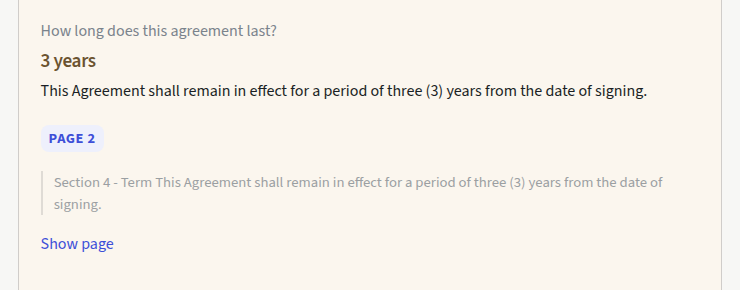
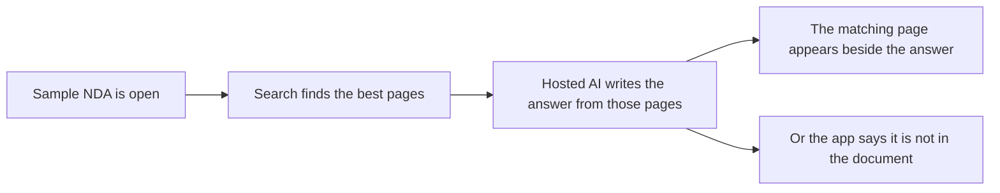

# PDF Q&A

> Answers from a PDF, with the matching page beside each answer.

[](https://github.com/RoxanaTapia/ai-doc-to-chat-pipeline/actions/workflows/ci.yml)
[](LICENSE)
[](https://ai-doc-pilot.roxanatapia.dev/)

🟢 **Live demo:** [ai-doc-pilot.roxanatapia.dev](https://ai-doc-pilot.roxanatapia.dev/)
▶ **Watch the demo:** [YouTube](https://youtu.be/MvB3kchanps)
📄 **The case:** [Read before you sign](https://roxanatapia.dev/cases/pdf-chat/)

[](https://ai-doc-pilot.roxanatapia.dev/)

## The case

Beta Labs, a fictional company, needs answers from an NDA the night before a kickoff. The sample NDA is already open. You ask in plain language, and the app shows the best-matching page beside each answer, or says the document does not cover the question.

This is a retrieval system, not a chatbot that guesses.

## What it does

- 📄 The [sample NDA](docs/product/sample-nda.pdf) is already loaded
- 🔎 The best-matching page appears beside each answer
- 💬 If the PDF does not cover the question, the app says so
- 🔒 Only a signed-in operator can upload a different PDF

You get the numbers printed in the PDF. The app does not calculate. Questions cover one file at a time. This is not a CRM, email, or ticketing tool.

## How it works



A shared library, sign-in for your organization, and a separate space per project wait until you want them for a real engagement. The way the pilot finds an answer stays the same.

On the shared demo, visitors stay on the sample NDA. Only the passages needed for an answer are sent to a hosted model. Use only sample or non-confidential documents there. A PDF an operator uploads is cleared when they leave or reset. When the demo has answered enough questions for the hour or the day, it asks you to try again later or [book a short call](https://roxanatapia.dev).

## For engineers

### Stack

Python 3.12, LangChain, FAISS and BM25 search, Streamlit, and a hosted model. Claude is the default. OpenAI and Grok are the other choices.

### Quickstart

```bash
git clone https://github.com/RoxanaTapia/ai-doc-to-chat-pipeline.git
cd ai-doc-to-chat-pipeline
cp .env.example .env
```

Set the model provider and its key in `.env`, as named in that file. Then:

```bash
docker compose --env-file .env -f deploy/docker-compose.yml up --build -d
```

The demo listens at [http://localhost:8501/app](http://localhost:8501/app). You can also run it with Python:

```bash
python3 -m venv .venv
. .venv/bin/activate
pip install -r requirements.txt
PYTHONPATH=src streamlit run apps/demo/app.py
```

Install and operator steps: [running the stack](docs/operators/running.md).

### Automated tests

```bash
pip install pytest "ruff==0.17.2"
ruff check .
ruff format --check .
PYTHONPATH=src:apps/demo pytest tests/ -q
```

GitHub Actions runs the automated tests and Ruff on every pull request and every push to main ([`.github/workflows/ci.yml`](.github/workflows/ci.yml)). Commands and layout: [AGENTS.md](AGENTS.md).

### Project structure

| Path | What you find |
|------|----------------|
| [`src/ai_doc`](src/ai_doc/) | The core: read the PDF, search, and produce the answer. Optional HTTP API in [`src/ai_doc/api`](src/ai_doc/api/) |
| [`apps/demo`](apps/demo/) | The pilot UI |
| [`configs/`](configs/) | Chunk size, search, and prompts |
| [`deploy/`](deploy/) | The files that package the pilot |
| [`tests/`](tests/) | Automated tests |
| [`docs/`](docs/README.md) | Product and operator pages |
| [`.env.example`](.env.example) | Product knobs. Copy to `.env`. Never commit a filled file |

The core uses semantic versions. Fixes go to the latest minor version of `ai-doc`. Pin an older commit when that exact tree should stay put. Details are in [support](SUPPORT.md).

What changed: [changelog](CHANGELOG.md). Report a vulnerability: [security](SECURITY.md). Bugs and product questions: [open an issue](https://github.com/RoxanaTapia/ai-doc-to-chat-pipeline/issues).

### How I build

I build with AI coding agents. Every change goes through a pull request I review and merge, with automated tests you can see on every change.

---

[MIT License](LICENSE) · [Roxana Tapia](https://github.com/RoxanaTapia) · [roxanatapia.dev](https://roxanatapia.dev) · [How I work with AI](docs/how-we-work.md)
