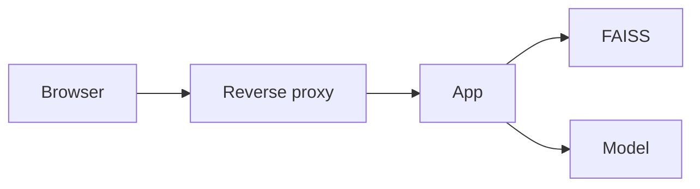
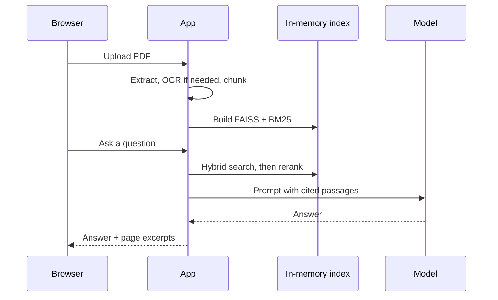
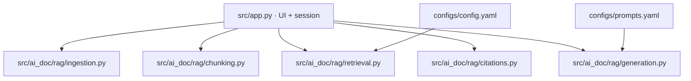

# Documentation

## Background

This page is the map of the repository. The [root README](../README.md) is the product overview. Start here when you want to know where code lives, how an answer is produced, and how work ships.

> **Takeaway:** Product code in `src/` and `configs/`. App containers in `deploy/`. A reverse proxy in front handles HTTPS. The app and the model stay behind it.

---

## Where to find what

```text
.
├── README.md          Client overview and live pilot
├── AGENTS.md          Tests, layout, and review
├── src/               Application code
├── configs/           Chunking, retrieval, and prompt tunables
├── tests/             pytest suite
├── deploy/            App image + Compose (Ollama; optional API)
├── .cursor/           Coding conventions
└── docs/              You are here
      product/         Architecture, walkthrough, sample NDA
      operators/       How to run the stack, layout rules, OCR checks
      archive/         Historical eval notes (not current)
```

| Path | Open it for |
|------|-------------|
| [`src/app.py`](../src/app.py) | Upload, chat UI, session index |
| [`src/ai_doc/rag/ingestion.py`](../src/ai_doc/rag/ingestion.py) | PDF → text + page numbers |
| [`src/ai_doc/rag/chunking.py`](../src/ai_doc/rag/chunking.py) | Header-aware chunking and section routing |
| [`src/ai_doc/rag/retrieval.py`](../src/ai_doc/rag/retrieval.py) | Hybrid search (FAISS + BM25 + RRF) and rerank |
| [`src/ai_doc/rag/citations.py`](../src/ai_doc/rag/citations.py) | Page excerpts, overlap filter, honesty guard |
| [`src/ai_doc/rag/generation.py`](../src/ai_doc/rag/generation.py) | Answer writing (Ollama or Anthropic) |
| [`src/ai_doc/ocr.py`](../src/ai_doc/ocr.py) | Scanned-page OCR |
| [`src/ai_doc/api/`](../src/ai_doc/api/) | Thin FastAPI `/health` and `/chat` |
| [`configs/config.yaml`](../configs/config.yaml) | Chunk size, hybrid weights, reranker |
| [`configs/prompts.yaml`](../configs/prompts.yaml) | Grounded-answer prompt |
| [`deploy/`](../deploy/) | App and model Compose. Public HTTPS sits behind an existing reverse proxy |
| [`docs/product/architecture.md`](product/architecture.md) | Request flow: reverse proxy, app, and model |
| [`docs/operators/REPO-STRUCTURE.md`](operators/REPO-STRUCTURE.md) | Extra layout rules |

---

## How an answer is produced

Two layers: the running services, then the Python modules that do the retrieval work.

### Runtime

The browser never talks to the index or the model directly. A reverse proxy in front terminates HTTPS. The app holds the session (PDF, chunks, FAISS) in memory. The model is Ollama beside the app, or Anthropic when that provider is selected.





### Code

Streamlit owns the session. Each retrieval step has its own module under `src/ai_doc/rag/`. Tunables come from YAML.



| Stage | Module | Role |
|-------|--------|------|
| Ingest | `ai_doc/rag/ingestion.py` | Read the PDF. Keep page numbers. OCR scanned pages. |
| Chunk | `ai_doc/rag/chunking.py` | Split on section headers so clauses do not bleed. |
| Index | `app.py` | Embed locally. Build FAISS and BM25 for this session. |
| Retrieve | `ai_doc/rag/retrieval.py` | Hybrid search (FAISS + BM25, RRF), then `bge-reranker`. |
| Filter | `ai_doc/rag/citations.py` | Drop near-duplicates. Refuse when context is too thin. |
| Generate | `ai_doc/rag/generation.py` | Write the answer from the shortlist only. |
| Show | `app.py` | Page + excerpt under the reply. |

The FastAPI app in `src/ai_doc/api/` exposes the same generation path as `/chat`. It does not replace the Streamlit retrieval loop.

---

## How work ships

See [AGENTS.md](../AGENTS.md) for how to run the tests, the repo layout, and review. Changes are reviewed and tested before merge.

---

## Docs in this folder

If you only want the product story, these three pages are enough:

| Page | What you get |
|------|----------------|
| [Architecture](product/architecture.md) | Reverse proxy, the app, and the model |
| [Walkthrough](product/demo-script.md) | What a live session shows, plus sample questions |
| [Sample NDA](product/sample-nda.pdf) | A ready PDF to upload |
| [Screenshots](screenshots/) | First paint, cited answer, refusal, booking line (real Streamlit renders) |

Contributor pages:

| Page | What you get |
|------|----------------|
| [Running the stack](operators/running.md) | Local Compose, and the app behind a reverse proxy |
| [Repo structure](operators/REPO-STRUCTURE.md) | Layout rules that are easy to break |
| [OCR testing](operators/testing-ocr.md) | How to verify scanned PDFs |
| [Archive](archive/) | Early local-Ollama eval rounds. Historical only. |

Live pilot: [ai-doc-pilot.roxanatapia.dev](https://ai-doc-pilot.roxanatapia.dev/).
