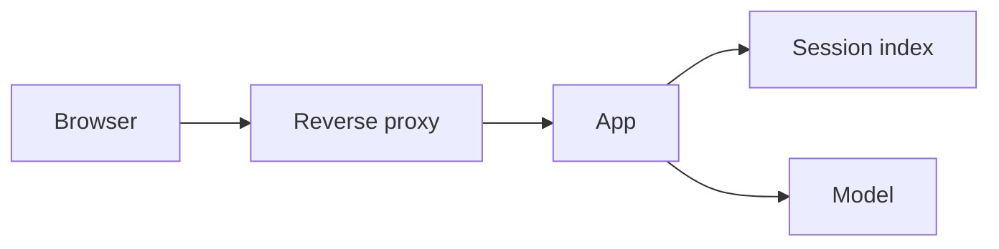
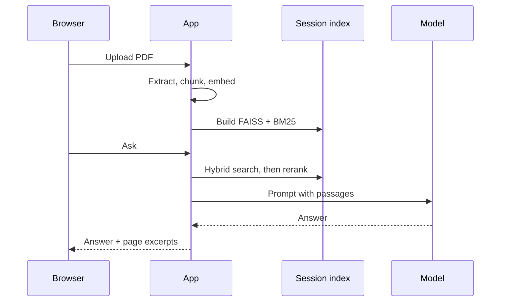

# Architecture

## Background

How a request moves through the product. For the retrieval steps and module map, see [docs/README.md](../README.md).

> **Takeaway:** A reverse proxy in front. The app and the model stay behind it. The PDF lives in memory for the session.

---

## What runs where

| Piece | Role | Where it lives |
|-------|------|----------------|
| **Reverse proxy** | HTTPS in front of the app. | An existing reverse proxy |
| **App** | Streamlit UI plus retrieval. The PDF, chunks, and FAISS index stay in memory. | This repo (`src/`, `deploy/`) |
| **Model** | Writes the answer. Ollama when you run it locally, or Anthropic when that provider is selected. | Beside the app, or a hosted API |

Embeddings always run with the app. Switching the writer (Ollama vs Anthropic) does not change search or citations.

Put the app behind an existing reverse proxy. The optional Compose overlay joins that proxy's Docker network and does not publish the app port. Operator commands: [running.md](../operators/running.md).

---

## One question

Nothing is written to a document library. Restart the app and you upload again. Model weights on disk are the only durable data (Ollama volume).

---

## What this pilot does not include yet

A shared library, SSO, and multi-project tenancy. Those wait for a real engagement. The retrieval core stays the same when they land.
