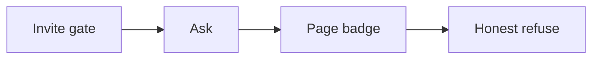

# Walkthrough

## Background

What a short session on the [live pilot](https://ai-doc-pilot.roxanatapia.dev/) should show. Request an invite on the gate; no approval is required.

> **Takeaway:** The sample NDA is already loaded. You tap a starter question, open the page it came from, then ask something the PDF cannot answer.

---

## What you will see

1. **Gate.** Request an invite, then open the app. The sample NDA is already loaded, under the name NDA, Acme Corp and Beta Labs. Visitors do not see an upload.
2. **Tap.** Tap a starter question. There are three: how long this lasts, which law applies, and the penalty fee. Each answer shows a page and section. Tap that chip to open the page with the passage highlighted.
3. **Honest miss.** The penalty fee is not in the PDF. The app says so, and that it searched the pages that produced text.
4. **End.** The sample walkthrough closes with a tally, Book a call, and Back to portfolio. The time on each answer is measured in the browser.

The PDF is kept only for this browser session, and cleared when you leave or reset. Each visit starts fresh.

Storyboard stills: [docs/screenshots](../screenshots/).

---

## Sample questions

### Sample NDA

1. How long does this last? (three years, Section 4, page 2 of the sample NDA)
2. Which law applies? (Spain, courts of Madrid, page 3 of the sample NDA)
3. What's the penalty fee? (The sample NDA does not name one.)

Sources for question 1 should stay on the term clause (page 2). Question 2 should point to governing law (page 3).

### Sample retention policy

1. How long are customer contracts retained after the relationship ends?
2. What happens to project working notes after a project closes?
3. What rule applies when Legal issues a litigation hold?

---

## Where the answer is written

| Choice | When |
|--------|------|
| **Claude** | The default. |
| **OpenAI** | When you set that provider. |
| **Grok** | When you set that provider. |

Search stays the same either way. The one list of settings is in [running the stack](../operators/running.md). How the pieces connect: [docs/README.md](../README.md).
