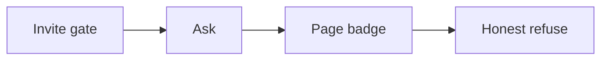

# Walkthrough

## Background

What a short session on the [live pilot](https://ai-doc-pilot.roxanatapia.dev/) should show. Request an invite on the gate; no approval is required.

> **Takeaway:** The sample NDA is already loaded. Ask, open the page citation, then ask something the PDF cannot answer.

---

## What you will see

1. **Gate.** Request an invite, then open the app. The sample NDA is already loaded.
2. **Ask.** Type in the question box, or tap a starter question. A short answer appears first, then a **Page N** badge and quote. **Show page** opens the passage highlighted.
3. **Refuse.** Ask something the PDF does not cover. The app keeps the exact miss sentence and notes that it searched the pages that produced text.
4. **Your PDF.** **Try your own PDF** is a small link. Do not upload real company files on the shared pilot.

The PDF is kept only for this browser session, and cleared when you leave or reset. Each visit starts fresh.

Storyboard stills: [docs/screenshots](../screenshots/).

---

## Sample questions

### Sample NDA

1. How long does this agreement last? (three years, Section 4, page 2)
2. Which country's law applies, and where are disputes settled? (Spain / courts of Madrid, page 3)
3. What is the penalty fee if Beta Labs breaks this agreement? (It does not name one.)

Sources for question 1 should stay on the term clause (page 2). Question 2 should cite governing law (page 3).

### Sample retention policy

1. How long are customer contracts retained after the relationship ends?
2. What happens to project working notes after a project closes?
3. What rule applies when Legal issues a litigation hold?

---

## Where the answer is written

| Choice | When |
|--------|------|
| **Ollama** | Answers stay on your server. |
| **Anthropic** | Optional, when you want quicker replies. |

Search and citations stay on the server either way. How the pieces connect: [docs/README.md](../README.md).
